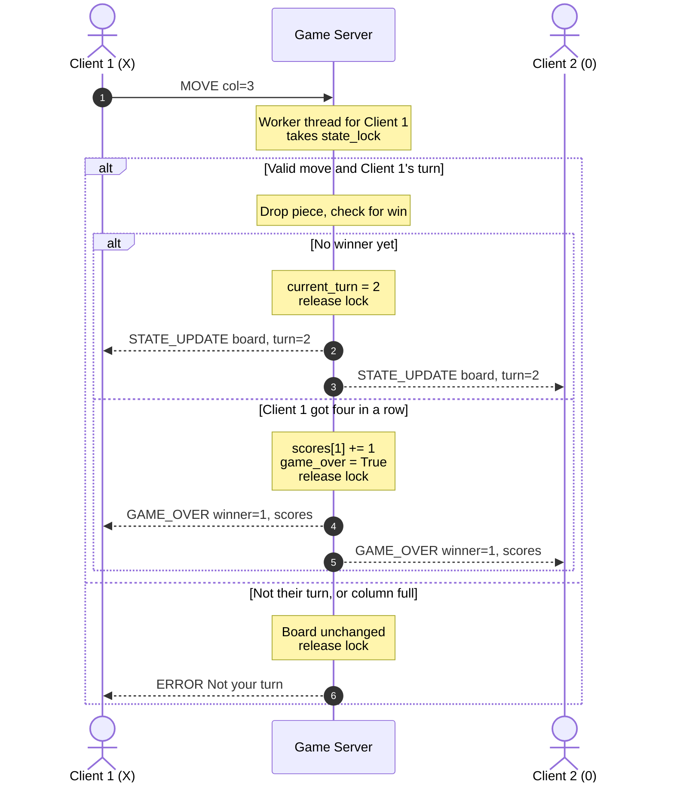

# Sequence Diagram

How a move gets validated and broadcast to both clients.

## Notes

Client 1 sends the column it wants to drop into. The client doesnt do any error checking that is done at the server.

The server checks that it is that cleints turn and that their placment if their piece is valid within bounds and has propper space.

Once the move is validated the server drops the piece into the lowest avalible place in that column, and also checks to see if it is a win. If a palayer won the score of that player is updated, if no win occurs the wserver updates the current_turn and sends updated state message out. 

So a single message is sent out to both clients with an upadted board and score.